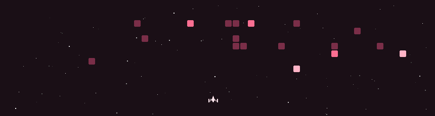

<div align="center">


</div>

<div align="center">

```
🌱 currently → architecting agent systems that reason, not just respond
🎯 focus     → llms · agent loops · mcp · grounded decision-making · evals
💭 belief    → the interesting part of ai isn't the prompt — it's the loop
```

</div>

---

<div align="center">

## 🌸 featured — agentic systems

</div>

<table>
<tr>
<td width="50%" valign="top">
<div align="center">

### 🩷 [buddy](https://github.com/nith2212/Buddy)

</div>

**a companion that helps you start, by finding out why you're stuck**

Most productivity apps track the task. Buddy tracks the person. It works out the real reason you're avoiding something (unclear, too big, fear, boredom, tiredness), offers one tiny move, and learns what helps you each week.

**the loop:**
`check in → diagnose → offer one move → learn`

- code decides each step, the llm only words it: a stage machine per framework
- every reply passes mechanical checks before it's sent (no therapy-speak, no moralizing)
- echo learns weekly patterns in plain code, so it can't invent anything
- 354 tests · hand-graded evals: framework adherence 25% → 86%


</td>
<td width="50%" valign="top">
<div align="center">

### 🌍 [atlas](https://github.com/nith2212/atlas)

</div>

**agentic global health intelligence** · [live demo ↗](https://atlas-ui-drab.vercel.app/)

Ask a question in plain English. Atlas picks the right analytical tool on its own, computes the answer from WHO data, and streams back an evidence-backed result. No dashboards, no SQL.

**the shape:**
`question → llm picks mcp tools → tools compute → evidence streams back`

- a standalone mcp server, so any mcp client (even claude desktop) can reuse the tools
- the model never computes a number, so it can't hallucinate one
- direction-aware analytics: lower pollution ranks better, lower life expectancy worse
- live progress and typed results over server-sent events


</td>
</tr>
</table>

---

<div align="center">

## 🌷 other builds

| 🌸 | project | stack |
|---|---|---|
| 🐱 | **nixly** *(ongoing)* — gamified photo cleanup: swipe to keep, delete, or revisit, wrapped in a cat sanctuary progression system | `react native` `expo` `typescript` |
| 🧬 | **long-term care plan curator** — agents that turn social determinants of health + clinical data into personalized care guidelines for copd & diabetes | `agents` `clinical data` `risk modeling` |
| 📄 | **contract mining assistant** — rag chatbot to query, edit & version dense pharmacy contracts, grounded in the real text | `vertex ai` `gcp` `rag` `pymupdf` |
| 🏫 | **campus connect** — microservices platform for students, faculty & admins · role-based access, events & resources | `spring boot` `jwt` `eureka` `react` `mysql` |

</div>

---

<div align="center">

## 🛠️ tech stack

<table>
<tr>
<td align="right"><b>ai &amp; agents</b></td>
<td>


</td>
</tr>
<tr>
<td align="right"><b>backend</b></td>
<td>


</td>
</tr>
<tr>
<td align="right"><b>data</b></td>
<td>


</td>
</tr>
<tr>
<td align="right"><b>frontend &amp; mobile</b></td>
<td>


</td>
</tr>
<tr>
<td align="right"><b>cloud &amp; tools</b></td>
<td>


</td>
</tr>
</table>

</div>

---

<div align="center">

## 💫 a little more about me

| | |
|---|---|
| 💻 | debugging by day, designing agent loops by night |
| 🎶 | powered by taylor swift and late-night architecture diagrams |
| 📚 | part-time reader, full-time romanticizer |
| 🧶 | crocheting thoughts into code |
| 🎬 | romcoms, sitcoms, and comfort stories |

</div>

---

<div align="center">

## 🚀 my contributions, under attack



</div>

---

<div align="center">

## 💌 let's connect

[](https://www.linkedin.com/in/nithyasri22/)

*always happy to talk agents, ai systems, or just good books 🌸*

</div>


